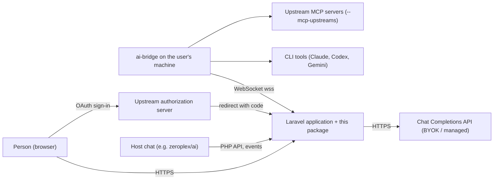
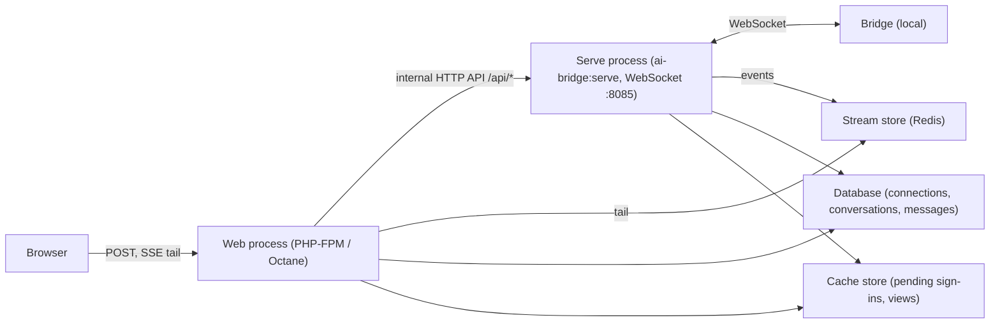

# Architecture

## Purpose

A Laravel package that gives an application one streaming interface to AI, whatever answers:
a Chat Completions API with the user's key (BYOK) or the application's key (managed), or the
user's own CLI tools (Claude, Codex, Gemini) on their machine through `@tetrixdev/ai-bridge`.
Every source becomes the same `StreamEvent`s, buffered per turn and tailed by the browser.

## Quality goals

1. **Refresh-safe streaming.** A reply survives a page refresh or a network blip: the browser
   tails a per-turn buffer with `Last-Event-ID`, never a one-shot stream.
2. **Secrets stay where they belong.** The server never holds the user's CLI credentials or an
   upstream's OAuth tokens; a card button is never something the assistant can call (decisions
   0005, 0007).
3. **Old and new bridges both work.** Wire changes are additive and capability-gated (0001).
4. **One code path per mode for the application.** The same callbacks, events and recorded
   messages in every mode.

## Context (C4 level 1)

The bridge connects out to the application, so the user's machine needs no open port.

## Containers (C4 level 2)

- **Web process**: the application's routes and this package's JSON routes. Starts turns, tails
  the stream store over SSE, records conversations. In BYOK/managed mode it calls the API itself
  and needs nothing else. It never holds a WebSocket.
- **Serve process** (`ai-bridge:serve`, `src/Server/`): the only process the bridges talk to.
  Accepts and authenticates bridge connections (JWT), keeps per-bridge state from `hello`, relays
  requests, turn input, file transfers, `mcp_request` and sign-in frames, and writes stream events
  into the store. The web process reaches it through its internal HTTP API (`/api/request`,
  `/api/request/input`, `/api/status`, `/api/mcp`, `/api/upstream/*`, ...).
- **Bridge**: `@tetrixdev/ai-bridge`, a separate project; runs the CLI and upstream MCP servers.
- **Stream store**: per-turn event log, status and metadata keyed by `request_id`; Redis by
  default (`ai-bridge.stream_store`), replaceable through `StreamStore::extend()`.
- **Cache store**: what the serve process writes and the web process reads outside a turn (pending
  upstream sign-ins, recorded upstream views); must be shared by both processes.
- **Database**: three package tables (`ai_bridge_connections`, `_conversations`, `_messages`).

## Key concepts

- **Modes**: BYOK, managed, CLI bridge ([README](../README.md#modes-of-operation)).
- **Turn and `request_id`**: one assistant reply; its events, buffered in the stream store.
- **Block model**: stream events open, fill and close blocks (text, thinking, tool use)
  ([PROTOCOL.md](../PROTOCOL.md#block-model)).
- **`hello` capabilities**: what a bridge says it supports; gates every newer frame.
- **Tools**: server tools run in the application and are resolved over the bridge; a tool may
  name a `ui://` view drawn as a card (MCP Apps).
- **Upstreams**: MCP servers on the machine whose views and OAuth sign-in this package relays.
- **Turn input**: a message reaching a turn that is still running.

## Risks

- **Two processes, shared state.** A cache store of `array`, or Redis not shared, silently breaks
  sign-ins and stream tails across processes.
- **Proxies.** A reverse proxy that buffers responses or intercepts 502/503 breaks SSE and the
  bridge connection (see the CHANGELOG's 0.16.0-RC1 upgrading note).
- **JSON routes without CSRF.** They run in the `api` group; with session-cookie auth the host
  must add CSRF protection ([README](../README.md#tools-from-the-machines-own-mcp-servers-upstream-mcp-apps-and-sign-in)).
- **Hand-maintained chat bundle.** `resources/dist/ai-bridge-chat.js` has no build step and only
  manual browser tests.
- **Protocol drift.** PROTOCOL.md and the bridge project must move together; a frame sent to a
  bridge that did not announce it is logged and never answered.
